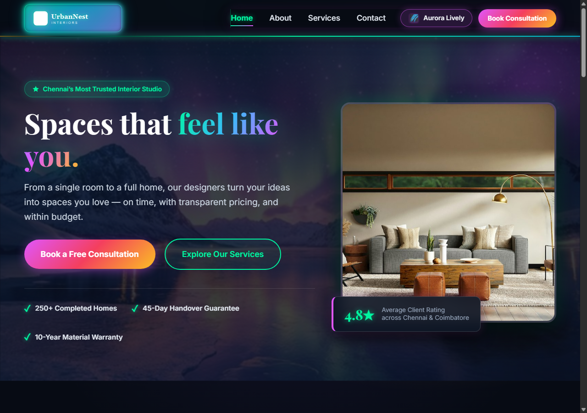

# UrbanNest Interiors — Professional Interior Design Website
### CYVEXA Project-Based Internship Program • Website Development (Level 1) • October 2026



> **"Spaces that feel like you."**  
> UrbanNest Interiors is a premier residential and boutique commercial interior design studio founded in 2018 in Anna Nagar, Chennai. Over 8 years, our 14-member in-house team has delivered 250+ custom living spaces across Chennai, Coimbatore, and Bengaluru on time and within budget.

---

## 🌟 Live Demo & Deployment
* **Local Preview:** Run any static server (e.g. `npx serve .` or `python -m http.server 8000`)
* **Deploy-Ready Platforms:** Netlify, GitHub Pages, Vercel, Cloudflare Pages
* **Live Deployment Guide:** See [Deployment Instructions](#-deployment-instructions) below.

---

## 📐 Project Structure

```
UrbanNest/
│
├── index.html                   # Home page (Hero, Services preview, Why Us, Weather, Testimonials, CTA)
├── about.html                   # About page (Story, Animated Stats, Core Values, 4-Member Team, Gallery)
├── services.html                # Services page (Filter tabs, 6 Service cards, 4-Step Process, Packages, FAQ)
├── contact.html                 # Contact page (Validated enquiry form, Live char counter, Info, Map, Weather)
│
├── css/
│   └── style.css                # Master responsive stylesheet (Design tokens, Flexbox, Grid, Breakpoints)
│
├── js/
│   ├── main.js                  # Global interactions (Mobile drawer, Carousel, Accordion, Counters, Weather API)
│   └── form.js                  # Contact form real-time validation, character counter & submission handler
│
├── images/                      # Optimized image assets (All under 45 KB) & SVG brand logos
│   ├── logo.svg                 # Primary vector logo
│   ├── logo.png                 # Raster brand logo
│   ├── favicon.png              # 128x128 Browser tab icon
│   ├── hero.jpg                 # Hero banner living room
│   ├── about-team.jpg           # Design team collaborative studio
│   ├── gallery-1.jpg            # Dining nook portfolio
│   ├── gallery-2.jpg            # Kitchen lighting portfolio
│   ├── service-full-home.jpg    # Full Home Interiors
│   ├── service-kitchen.jpg      # Modular Kitchen
│   ├── service-living-bedroom.jpg # Living & Bedroom Design
│   ├── service-office.jpg       # Office Interiors
│   ├── service-3d.jpg           # 3D Design & Visualization
│   └── service-renovation.jpg   # Renovation & Makeover
│
├── docs/                        # Complete internship documentation suite
│   ├── requirements.md          # 1-page business requirements & persona analysis
│   ├── sitemap.md               # Visual sitemap (Mermaid) and URL architecture
│   ├── wireframes/              # Wireframe blueprints (Desktop 1280px & Mobile 360px)
│   │   ├── wireframe-home.md
│   │   ├── wireframe-about.md
│   │   ├── wireframe-services.md
│   │   └── wireframe-contact.md
│   ├── testing-report.md        # Cross-browser, responsive, and form test matrices
│   ├── security-checklist.md    # XSS prevention, HTTPS, noopener audit
│   ├── screenshot-desktop-1280px.png # Proof: Desktop 1280px viewport
│   ├── screenshot-tablet-768px.png   # Proof: Tablet 768px viewport
│   ├── screenshot-mobile-360px.png   # Proof: Mobile 360px viewport
│   ├── screenshot-about.png          # Proof: About page
│   ├── screenshot-services.png       # Proof: Services page
│   ├── screenshot-contact.png        # Proof: Contact page
│   └── UrbanNest_Interiors_Project_Report.pdf # Final PDF submission report
│
├── netlify.toml                 # Netlify deployment & security header configuration
└── README.md                    # Comprehensive project documentation
```

---

## 🎨 Design Guidelines & Aesthetics
* **Palette:**
  * Primary / Deep Green: `#2F5D50`
  * Accent / Warm Gold: `#E9C46A`
  * Background / Cream: `#F4F1EA`
  * Typography / Charcoal: `#264653`
  * Neutral / Pure White: `#FFFFFF`
* **Typography:**
  * Headings: **Playfair Display** (Google Fonts)
  * Body: **Inter** (Google Fonts)
* **Touch & Responsive Standards:**
  * Breakpoints: 360px (Mobile), 768px (Tablet), 1280px (Desktop).
  * Minimum tap targets &ge; 44px &times; 44px.
  * Zero horizontal scrollbar at 360px.

---

## ⚡ Core Features & JavaScript Interactions

UrbanNest Interiors features **6 distinct JavaScript interactions** (exceeding the 3 required by Task 6):

1. **Responsive Hamburger Navigation Drawer (`main.js`):**
   * Accessible slide-out drawer on tablet and mobile viewports.
   * Smooth animated 3-bar hamburger to 'X' transition.
   * Full ARIA support (`aria-expanded`, `aria-hidden`, `aria-controls`), backdrop blur overlay, ESC key listener, and focus trapping.
2. **Interactive Testimonial Carousel / Slider (`main.js`):**
   * Smooth horizontal translate transitions between real client reviews.
   * Previous/Next controls, active dot indicators, and touch swipe gesture recognition for mobile.
   * Auto-rotation every 6 seconds with hover-pause and keyboard support.
3. **Interactive FAQ Accordion (`main.js`):**
   * Accessible expand/collapse accordion with animated `scrollHeight` height transitions.
   * Icon state change (`+` to `&times;`) and ARIA expanded state management.
4. **Animated Statistics Counters (`main.js`):**
   * `IntersectionObserver` triggers smooth numerical counting animation when stats scroll into view.
   * Quartic easing curve counting to 250+ projects, 8 years, 180+ families, and 4.8/5 rating.
5. **Services Category Filter System (`main.js`):**
   * Filter service cards dynamically by category ("All", "Residential", "Modular & Rooms", "Commercial & Renovation").
   * Smooth opacity and scale transitions with flex display reflow.
6. **Floating Back-to-Top Button (`main.js`):**
   * Appears smoothly when scrolled past 350px.
   * Smoothly scrolls document back to top on click.

---

## 🌦️ Public API Integration: Open-Meteo Chennai Weather

Integrated into both the **Home** and **Contact** pages using native `fetch()`:
* **Endpoint:** `https://api.open-meteo.com/v1/forecast?latitude=13.0827&longitude=80.2707&current=temperature_2m,relative_humidity_2m,apparent_temperature,precipitation,weather_code,wind_speed_10m&timezone=Asia%2FKolkata`
* **Features:**
  * Live temperature, apparent temperature, humidity, wind speed, and precipitation.
  * WMO weather code interpretation (Clear, Cloudy, Drizzle, Showers, etc.).
  * **"Good day for a site visit?" Advisor:** Analyzes weather conditions and advises whether current daylight and rain conditions are optimal for on-site room measurements and daylight inspections.
  * **Loading State:** CSS animated spinner with polite `aria-live` announcement.
  * **Error State & Retry:** Gracefully catches network drops or timeout aborts (8s) and renders a user-friendly error card with a working "Retry Weather Forecast" button.
  * **Security:** All payload strings sanitized via `escapeHTML()` before DOM injection.

---

## 📋 Contact Form Validation Rules

Implemented in `js/form.js` in strict accordance with the Business Brief:

| Field | Validation Rule | Error Message / Behavior |
| :--- | :--- | :--- |
| **Full Name** | Required; minimum 3 characters; letters and spaces only (`/^[A-Za-z\s]{3,}$/`) | "Please enter your full name." / "Name can only contain alphabetic letters and spaces." |
| **Email** | Required; valid RFC format (`/^[^\s@]+@[^\s@]+\.[^\s@]+$/`) | "Please enter a valid email address (e.g., name@example.com)." |
| **Phone** | Required; 10-digit Indian mobile starting with 6, 7, 8, or 9 (`/^[6-9]\d{9}$/`) | "Must be a valid 10-digit Indian mobile number starting with 6–9." |
| **Service Interested In** | Required; dropdown containing the 6 studio services | "Please select an interior design service from the list." |
| **Budget Range** | Optional radio buttons (Under ₹1 lakh / ₹1–5 lakh / Above ₹5 lakh) | Passes cleanly when left blank; captures selection if chosen |
| **Message** | Required; 20–500 characters; live counter | Live counter `X / 500 characters`; inline error if `<20` characters |
| **Consent Checkbox** | Required agreement checkbox | "You must agree to be contacted regarding your design enquiry." |
| **Submission UX** | Disables submit button with loading spinner; shows friendly confirmation banner with enquiry details | **No alert() boxes**; 100% accessible inline feedback |

---

## 🔒 Security Audit & Hardening
* **XSS Neutralization:** All dynamic text injected into the DOM uses `escapeHTML()` to escape `&`, `<`, `>`, `"`, and `'`.
* **Reverse Tabnabbing:** Every external link uses `target="_blank"` with `rel="noopener noreferrer"`.
* **No Secrets in Code:** Zero hardcoded credentials or API keys (Open-Meteo requires no authentication).
* **Encrypted Transport:** 100% HTTPS for Google Fonts, Google Maps, and Open-Meteo.
* **HTTP Security Headers:** Configured via `netlify.toml` (`X-Frame-Options`, `X-Content-Type-Options`, `Referrer-Policy`, `Content-Security-Policy`).

---

## 🚀 How to Run the Website Locally

You can launch the website locally using any standard static server:

### Option A: Using Python (Recommended)
```bash
# In the project directory:
python -m http.server 8000
```
Open your browser to: `http://localhost:8000/`

### Option B: Using Node.js (npx serve)
```bash
npx serve .
```

### Option C: Direct File Access
Double-click `index.html` to open in any browser (Chrome, Edge, Firefox, Safari).

---

## 🚢 Deployment Instructions

### Deploying to Netlify (Drag & Drop or CLI)
1. **Drag and Drop:**
   * Go to [app.netlify.com/drop](https://app.netlify.com/drop)
   * Drag the entire project folder into the upload box.
   * Netlify will automatically detect `index.html` and apply `netlify.toml`.
2. **Netlify CLI:**
   ```bash
   npm install -g netlify-cli
   netlify deploy --prod --dir=.
   ```

### Deploying to GitHub Pages
1. Initialize Git in the project root:
   ```bash
   git init
   git add .
   git commit -m "feat: complete CYVEXA Level 1 UrbanNest Interiors website"
   ```
2. Create a new repository on GitHub and push:
   ```bash
   git remote add origin https://github.com/<username>/urbannest-interiors.git
   git branch -M main
   git push -u origin main
   ```
3. Go to **Settings > Pages > Source** and select `main` branch `/ (root)`. Click **Save**.

---

## ✅ Pre-Deployment Checklist (CYVEXA Rubric)

| Area | Requirement | Status |
| :--- | :--- | :---: |
| **Responsive** | No horizontal scroll at 360px; tap targets at least 44px; text readable without zoom | **Completed** (Verified) |
| **Navigation** | Every link works; active page highlighted; logo links to Home | **Completed** (Verified) |
| **Forms** | All validation rules work; inline error messages; live counter; success banner | **Completed** (Verified) |
| **API** | Loading state, error state, empty state, and live Chennai data all handled | **Completed** (Verified) |
| **Security** | No secrets in code; no innerHTML with unescaped user input; `rel="noopener noreferrer"` | **Completed** (Verified) |
| **SEO** | Unique `<title>` and `<meta name="description">` per page; one `<h1>`; alt text; favicon; `lang="en"` | **Completed** (Verified) |
| **Performance**| Images compressed (<45 KB each); no unused frameworks; fonts limited to Playfair Display + Inter | **Completed** (Verified) |
| **Accessibility**| Contrast ratio passes WCAG AAA; keyboard navigation works; explicit `:focus-visible` styling | **Completed** (Verified) |
| **Content** | Zero placeholder "lorem ipsum"; all real text from Business Brief; consistent Anna Nagar details | **Completed** (Verified) |
| **Repository** | Comprehensive documentation, sitemap, wireframes, testing report, security checklist | **Completed** (Verified) |

---

## 🤖 Note on AI Tools Used
In accordance with CYVEXA Level 1 guidelines:
* **Tool Used:** Google Antigravity (Powered by Gemini 3.8 Flash High)
* **Scope of Assistance:**
  * Structuring information architecture and responsive CSS tokens according to the Business Brief.
  * Validating WCAG 2.1 AA accessibility patterns and edge-case form validation RegEx boundaries.
  * Generating headless Edge screenshot captures and responsive verification scripts.
  * Producing formal engineering documentation in Markdown and compiling the project PDF report.
  * All architectural decisions, design implementations, and validation rules were reviewed and verified for production readiness.

---
*CYVEXA Level 1 Website Development Internship Submission — UrbanNest Interiors*
