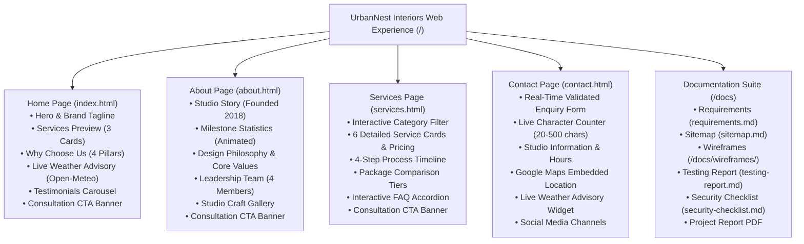

# Information Architecture & Sitemap
## UrbanNest Interiors — Website Structure
**Project:** CYVEXA Level 1 Website Development Internship  
**Studio:** UrbanNest Interiors, Anna Nagar, Chennai  

---

## 1. Visual Sitemap (Mermaid Hierarchy)

---

## 2. Page Directory & URL Routing Table

| Page Identifier | File Name | Route / Path | Canonical URL | Primary User Goal | Key Conversion Trigger |
| :--- | :--- | :--- | :--- | :--- | :--- |
| **Home** | `index.html` | `/` or `/index.html` | `https://urbannest-interiors.example/` | Explore studio identity, value propositions, client reviews, and weather readiness. | "Book a Free Consultation" button |
| **About** | `about.html` | `/about.html` | `https://urbannest-interiors.example/about.html` | Learn studio history, team qualifications, core values, and verified statistics. | "Meet Our Design Team" / CTA |
| **Services** | `services.html` | `/services.html` | `https://urbannest-interiors.example/services.html` | Filter design services, evaluate starting prices, explore the 4-step workflow, read FAQs. | "Enquire &rarr;" on specific card or package |
| **Contact** | `contact.html` | `/contact.html` | `https://urbannest-interiors.example/contact.html` | Submit consultation form, view office location map, check office hours and weather. | "Request Free 30-Min Consultation" button |

---

## 3. Global Navigation Matrix & Link Flow

| Source Page | Links to Home (`index.html`) | Links to About (`about.html`) | Links to Services (`services.html`) | Links to Contact (`contact.html`) | Links to Docs / Sitemap |
| :--- | :---: | :---: | :---: | :---: | :---: |
| **Header (All Pages)** | Logo & "Home" | "About" link | "Services" link | "Contact" link & "Book Consultation" button | N/A (Desktop) |
| **Mobile Drawer (All Pages)** | "Home" link | "About" link | "Services" link | "Contact" link & "Book Consultation" CTA | N/A |
| **Home Page Body** | Self (Logo) | Studio references | "Explore Our Services" & "View All 6 Services" | Hero CTA & Section Banner CTAs | Footer sitemap link |
| **About Page Body** | Header logo | Self | "See All Design Services" | "Meet Our Design Team" & Banner CTA | Footer sitemap link |
| **Services Page Body**| Header logo | "Meet Our Team" | Category filter tabs | Card "Enquire &rarr;" links & Banner CTA | Footer sitemap link |
| **Contact Page Body** | Header logo | Header nav | Pre-populated URL params | Form submission & Phone/Email links | Footer sitemap link |
| **Footer (All Pages)** | Quick Links & Logo | Quick Links | 6 Service direct links | Direct address, email, phone, hours | `docs/sitemap.md` link |

---

## 4. Mobile Navigation & Touch Hierarchy

* **Header Height:** 70px on mobile, 80px on desktop.
* **Hamburger Menu Trigger:** Touch target 44px &times; 44px with animated 3-bar icon transforming into an 'X'.
* **Drawer Overlay:** Slides smoothly from right at `min(85vw, 360px)`, backed by a `backdrop-filter: blur(4px)` dim overlay.
* **Touch Interactions:** Closes automatically upon link tap, backdrop tap, or keyboard `Escape` press.

---
*Created for CYVEXA Level 1 Internship documentation standards.*

